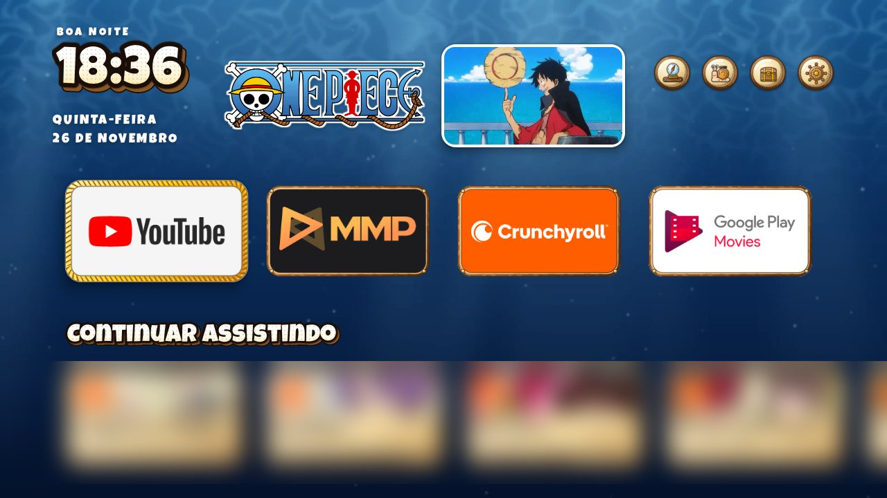
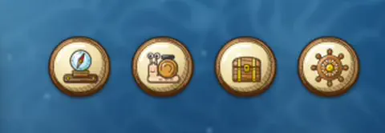
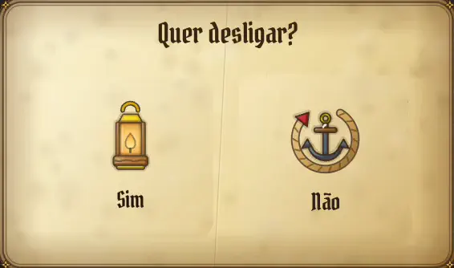
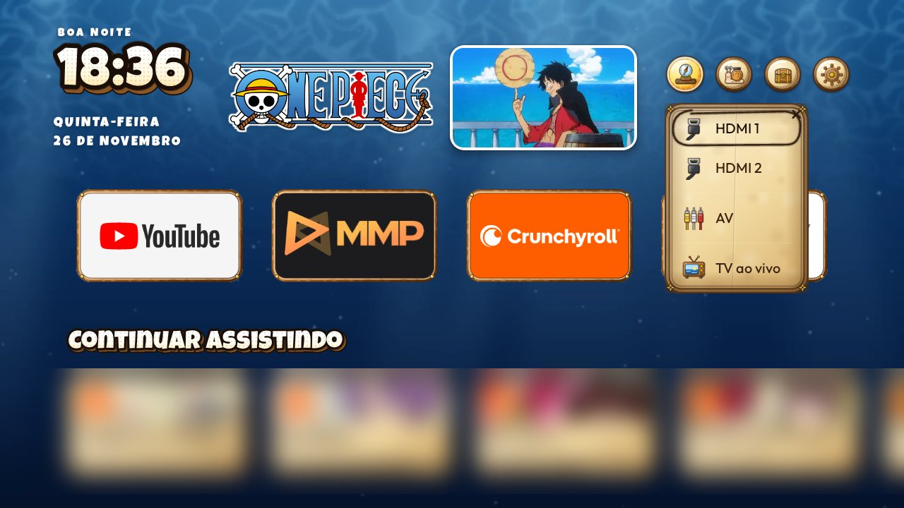
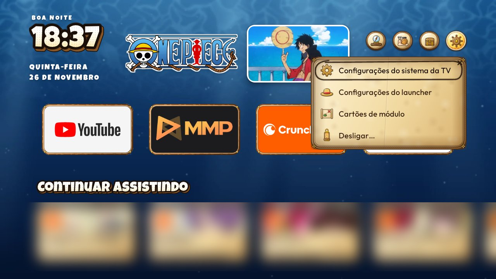
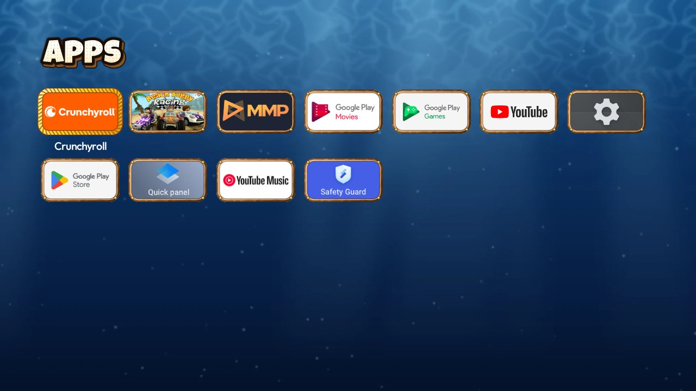
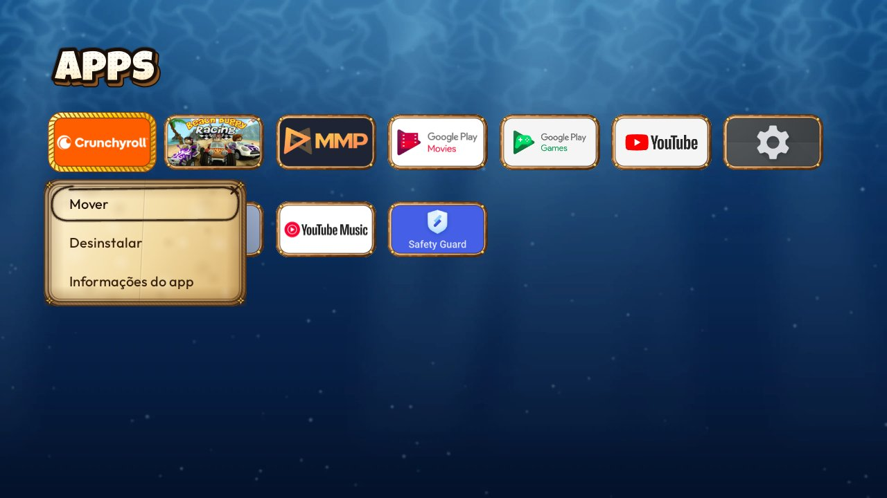
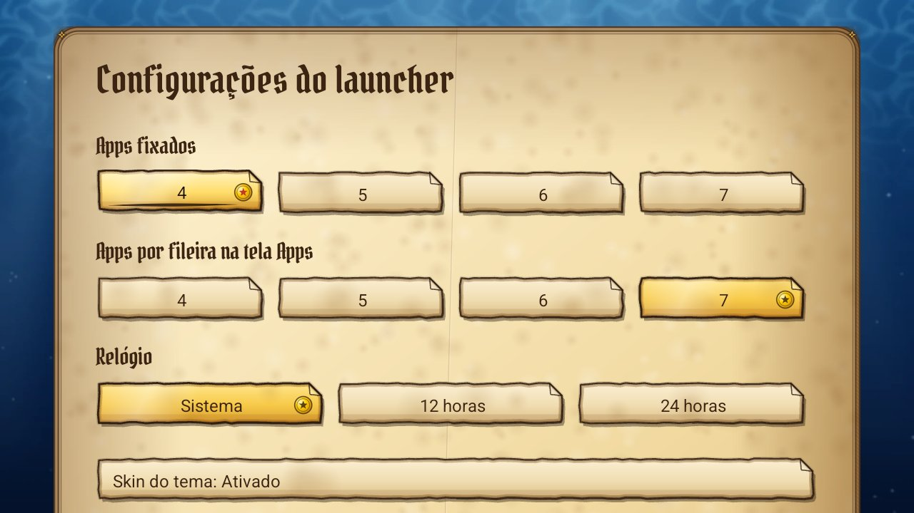
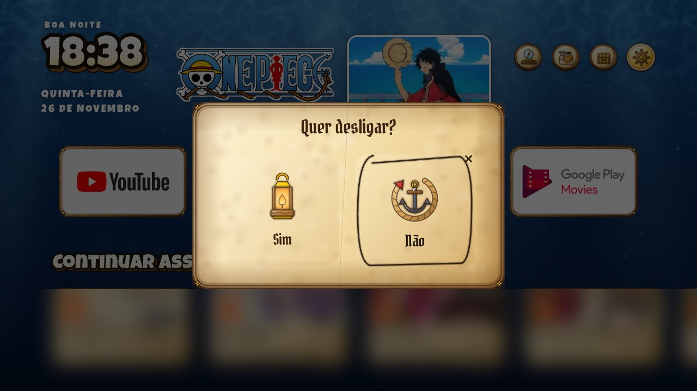

<p align="center">
  
</p>

<h1 align="center">One Piece — launcher para Android TV</h1>

<p align="center">
  Um launcher com tema de One Piece para a TCL 32S5K (Google TV 14), feito como fork do
  <a href="https://github.com/Gathin23/cleanyourtv">CleanYourTV</a>.
</p>

---

Este repositório nasceu de um fork do [CleanYourTV](https://github.com/Gathin23/cleanyourtv), um projeto que tira os
apps inúteis de qualquer Android TV pelo Wi-Fi e troca a tela inicial cheia de anúncios por um launcher limpo. Aqui o
launcher dele (`com.gathin.tvhome`) ganhou uma **skin completa de One Piece** e uma Home mais simples, ajustadas
para uma TV específica: a **TCL 32S5K (placa G13, Google TV 14)**.

A documentação original do CleanYourTV (limpeza da TV, listas por modelo, ferramentas, restauração) continua neste
repositório, em **[CLEANYOURTV.md](CLEANYOURTV.md)**. Tudo o que ela descreve continua valendo aqui.

> **Build pessoal.** Este launcher usa arte de terceiros, pede acesso à internet (para as capas do Continuar
> assistindo) e passa do limite de tamanho do APK do projeto original. Por isso ele vive neste fork e não volta
> para o CleanYourTV.

## O que tem

### Home



- **Cabeçalho:** relógio e data com letreiro de título de anime (Luckiest Guy) e um brilho que passa pelas letras,
  o logo de One Piece e um painel de mangá com o Luffy.
- **Apps fixados:** quatro tiles grandes em molduras de madeira entalhada; o foco é uma corda dourada trançada
  (vermelha enquanto o app está sendo movido).
- **Continuar assistindo:** os episódios em andamento, lidos da tabela Watch Next do Android, com a capa de cada
  um baixada por https, o ícone do app e a barra de progresso. Um card por série, o mais recente primeiro. Nas
  imagens desta página essa fileira aparece borrada de propósito.
- **Ícones do topo**, desenhados como cels de anime: Log Pose (entradas), Den Den Mushi (rede), baú do tesouro
  (todos os apps) e timão (configurações).

### Animações

| | |
|---|---|
|  | **Cumprimento do Luffy.** Ao voltar para a Home (de um app ou do HDMI, com o botão Home do controle), o Luffy diz a fala dele em japonês enquanto o balão escreve o texto no idioma da TV. Depois fica girando o chapéu. |
|  | **Ícones do topo.** Cada um tem seu movimento e seu som ao receber foco: a agulha do Log Pose balança, o Den Den Mushi toca, o baú abre e solta moedas, o timão gira um oitavo de volta. |
|  | **Menu de desligar.** A chama da lanterna (Sim) tremula, apaga num fio de fumaça e acende de novo; a corda da âncora (Não) dá a volta. O foco começa em Não. |
|  | **Abertura e protetor de tela.** A cada vez que a TV liga, o logo pousa no mar com linhas de velocidade, brilho e espuma (cerca de 3,6 s; qualquer tecla pula). Depois de 10 minutos parada, a mesma cena vira o protetor de tela, com o logo flutuando devagar para não marcar a tela. |

### Menus e telas

| | |
|---|---|
|  | **Entradas** (Log Pose): HDMI, AV e TV ao vivo num pergaminho, cada uma com seu ícone desenhado. |
|  | **Timão:** configurações da TV, configurações do launcher, cartões de módulo e Desligar. |
|  | **Tela Apps** (baú): todos os apps, de 4 a 7 por fileira. |
|  | **Segurar OK num app:** Mover, Desinstalar (só apps instalados pelo dono, pela confirmação do próprio Android) e Informações do app. Na Home, os fixados também podem ser trocados por outro app. |
|  | **Configurações do launcher:** quantos apps fixados, quantos apps por fileira na tela Apps, formato do relógio e a skin ligada ou desligada. |
|  | **Desligar:** o menu próprio do launcher, porque o do Android tem o layout de celular e não dá para usar com o direcional. Sim põe a TV em standby. Não tem Reiniciar: na 32S5K, reiniciar volta em standby, igual a desligar. |

### Outros detalhes

- Sons próprios para clique e foco em cada botão.
- Menus, painéis, diálogos e cards de pergaminho com borda de mapa.
- Com a skin desligada, o launcher volta a um visual plano: fundo azul-escuro e texto branco.
- O nome do app é **One Piece** em todos os idiomas.

## Instalar

Precisa de JDK 17, Android SDK 34 e uma TV com ADB pela rede ligado. A instalação segue a do CleanYourTV
([CLEANYOURTV.md](CLEANYOURTV.md) e [docs/launcher.md](docs/launcher.md)), com dois cuidados:

1. **Instale sempre com `HOME_KEY_SERVICE=1`.** O serviço da tecla Home é quem faz o botão Configurações do
   controle abrir o painel, o Luffy saber que você apertou Home e o menu de desligar funcionar:

   ```bash
   TV_HOST=<tv ip> HOME_KEY_SERVICE=1 launcher/build-and-install.sh
   ```

2. **Ligue a skin com um tema.** Crie uma pasta com este `config.json` e envie com `tools/theme.sh`:

   ```json
   {
     "skin": "one_piece",
     "wallpaper": false,
     "background_color": "#0B2A4A",
     "header_white": true,
     "show_greeting": true,
     "ambient_glow": false,
     "app_glow": false,
     "clock_wallpaper": false
   }
   ```

   ```bash
   TV_HOST=<tv ip> tools/theme.sh <pasta-do-tema>
   ```

A configuração da TCL 32S5K (quatro tiles fixados, tela Apps, Continuar assistindo, menu do timão) está em
[`launcher/app/src/main/res/values/config.xml`](launcher/app/src/main/res/values/config.xml).

## Gravar telas para a documentação

As animações acima foram gravadas na TV com [`tools/screenrec.py`](tools/screenrec.py). Ele grava a tela
enquanto aperta teclas do controle por uma segunda conexão, puxa o vídeo e, com `--webp`, recorta e converte
para um WebP animado em loop:

```bash
printf 'input keyevent DPAD_RIGHT\nsleep 2\ninput keyevent DPAD_RIGHT\n' > keys.txt
TV_HOST=<tv ip> tools/venv/bin/python tools/screenrec.py clip.mp4 10 keys.txt \
  --webp docs/one-piece/clip.webp --crop 320:110:905:50 --fps 15 --width 480
```

Precisa do ffmpeg no PATH ou do pacote `imageio-ffmpeg`. Antes de publicar, recorte ou borre o que for pessoal:
o Continuar assistindo, nomes de rede Wi-Fi, contas e nomes de dispositivo.

## Créditos

- [CleanYourTV](https://github.com/Gathin23/cleanyourtv), de Gathin23 e colaboradores: o launcher, as
  ferramentas e as listas de limpeza em que este fork se apoia. Licença MIT.
- One Piece é uma obra de Eiichiro Oda (Shueisha, Toei Animation). Os nomes, personagens e a arte usados na skin
  pertencem aos seus donos; este é um projeto pessoal de fã, sem fins comerciais.
