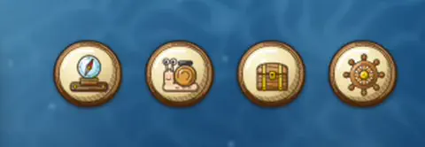
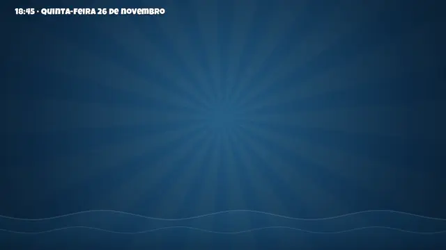

# Launcher One Piece — documentação técnica

Implementação da skin One Piece: ícones e molduras desenhados em código, fontes, painel do personagem com balão de
fala, abertura, protetor de tela, efeitos sonoros e otimizações de CPU e memória, com o método de medição de cada
uma. Instalação e uso estão no [README](../../README.md).

Código-fonte: `launcher/app/src/main/java/com/gathin/tvhome/`. Recursos: `launcher/app/src/main/res/`.

**Nome de pacote:** o app é instalado como `io.github.paulouuul.onepiecetv` (`launcherApplicationId` em
`launcher/gradle.properties`), e não como o `com.gathin.tvhome` do CleanYourTV. As classes continuam no pacote Java
`com.gathin.tvhome`, então os componentes são escritos por extenso, por exemplo
`io.github.paulouuul.onepiecetv/com.gathin.tvhome.MainActivity`. `launcher/build-and-install.sh` e `tools/theme.sh`
leem o nome do `gradle.properties`, e a variável `LAUNCHER_ID` o substitui.

## Sumário

1. [Visão geral](#1-visão-geral)
2. [Ícones vetoriais](#2-ícones-vetoriais)
3. [Pílulas, molduras e superfícies](#3-pílulas-molduras-e-superfícies)
4. [Fontes](#4-fontes)
5. [Painel do personagem](#5-painel-do-personagem)
6. [Abertura e protetor de tela](#6-abertura-e-protetor-de-tela)
7. [Texto com realce animado](#7-texto-com-realce-animado)
8. [Efeitos sonoros](#8-efeitos-sonoros)
9. [Otimização de CPU e memória](#9-otimização-de-cpu-e-memória)
10. [Medição](#10-medição)
11. [Substituição de recursos](#11-substituição-de-recursos)

## 1. Visão geral

A skin é ativada pela chave `"skin": "one_piece"` no `config.json` do tema (`OnePieceSkin.on(cfg)`). Com a skin
desativada, nenhum dos componentes abaixo é executado e o launcher usa o tema plano.

| Arquivo | Responsabilidade |
|---|---|
| `OnePieceSkin.java` | Aplicação da skin nas telas, fundo, fontes e efeitos sonoros. |
| `OnePieceIcon.java` | Ícones da barra superior, do menu de desligar e das linhas de menu, com animação de foco. |
| `OnePiecePill.java` | Pílulas da barra superior e estado de foco. |
| `OnePieceFrames.java` | Molduras dos tiles, indicador de foco, superfície dos cards, bordas e marcadores de menu. |
| `OnePieceText.java` | Texto do relógio e dos títulos de seção, com realce animado. |
| `LuffyGreeting.java` | Painel do personagem: animações, áudio, balão de fala e modo de repouso. |
| `OnePieceIntro.java` | Animação de abertura e, em loop, cena do protetor de tela. |
| `OnePieceScreensaver.java` | Composição do protetor de tela a partir da abertura. |
| `PowerMenuActivity.java` | Diálogo de confirmação de desligamento. |

Ícones, molduras, pílulas e superfícies são desenhados em tempo de execução com `Canvas` (caminhos, degradês e
traços), sem bitmaps por densidade. Os únicos recursos raster são o logo, os dois fundos de tela cheia e as duas
animações do personagem.

Todas as animações respeitam a chave `reduced_motion` do `config.xml`. Com ela ativa, os ícones não são animados, a
abertura é substituída por um logo estático com fade e o protetor de tela fica estático.

## 2. Ícones vetoriais



`OnePieceIcon` é um `Drawable` que desenha cada ícone num **sistema de coordenadas de 24 × 24 unidades**. O `draw()`
aplica `translate` e `scale` para os limites do drawable (cerca de 32 px em 720p) e despacha para o método do ícone.
O mesmo desenho atende qualquer tamanho e densidade.

### Pipeline de desenho

Cada forma é desenhada em três passos:

1. **Preenchimento** (`cel()`): `LinearGradient` diagonal, do canto superior esquerdo ao inferior direito, da cor base
   clareada em 40% até a cor base.
2. **Sombra** (`cel()`): recorte pelo caminho da forma (`clipPath`), exclusão do mesmo caminho deslocado para cima e
   para a esquerda (`clipOutPath`) e preenchimento da área restante com a cor base escurecida em 32%. A sombra tem
   borda nítida, sem desfoque.
3. **Contorno** (`brush()`): um traço largo com alfa baixo (cerca de 18%), que simula desfoque sem custo de
   processamento, e, sobre ele, um traço fino deslocado para o lado da sombra, em marrom-escuro semitransparente.

Funções auxiliares: veios de madeira (`grain()`), realces curvos (`glint()`) e estrelas de quatro pontas
(`star()`). A largura mínima de linha é de cerca de 1 px na tela; linhas mais finas produzem cintilação em 720p.

### Ícones e animações de foco

| Ícone | Uso | Animação de foco | Duração |
|---|---|---|---|
| Log Pose (bússola) | Entradas | rotação oscilante da agulha e realce atravessando o vidro | 1,5 s |
| Den Den Mushi | Rede | piscada, vibração, deslocamento do fone e ondas sonoras; olhos fechados e "z" quando sem rede | 1,15 s |
| Baú | Apps | abertura da tampa, moedas em trajetória com rotação, compressão do baú ao fechar | 1,35 s |
| Timão | Configurações | rotação de 45° com linhas de movimento e retorno elástico | 0,95 s |
| Lanterna | Desligar: Sim | oscilação da chama, extinção com fumaça e reacendimento | 1,7 s |
| Âncora com corda | Desligar: Não | rotação completa da corda e oscilação da âncora | 1,3 s |
| HDMI, RCA, TV, engrenagem, quadro, concha, chapéu, mapa | linhas de menu | animações curtas específicas de cada ícone | 1,1 s |

### Implementação da animação

Cada ícone possui um `ValueAnimator` de 0 a 1 com `LinearInterpolator`. `nudge()` inicia a animação quando o ícone
recebe foco; a cada quadro o progresso `t` é atualizado e o drawable chama `invalidateSelf()`. Os métodos de desenho
derivam ângulos, posições e opacidades de `t` (funções seno e `bump()`, uma curva de ida e volta entre 0 e 1).

Fora da animação o drawable não é invalidado e não consome CPU. Uma nova chamada a `nudge()` durante uma animação em
curso é ignorada, de modo que a animação continua em vez de reiniciar. O timão acumula o ângulo, e cada foco
adiciona 45° a partir da posição atual.

## 3. Pílulas, molduras e superfícies

**Pílulas** (`OnePiecePill`):
- **Aparência:** aro com textura de madeira em degradê, face com textura de papel e bordas escurecidas, sombra
  hachurada e realce no canto superior esquerdo.
- **Foco:** a face passa a dourado, linhas radiais giram atrás do ícone, um realce atravessa a pílula e uma estrela
  pisca.
- **Cache:** as camadas estáticas são renderizadas uma vez por tamanho e estado num bitmap; a cada quadro só a
  animação de foco é desenhada.

**Molduras e marcadores** (`OnePieceFrames`):

| Classe | Uso | Descrição |
|---|---|---|
| `Wood` | tile sem foco | moldura com textura de madeira, bisel e rebites nos cantos |
| `Rope` | tile com foco | corda trançada dourada (vermelha durante a movimentação de um app); ao receber foco, as tranças se deslocam ao longo da corda, um realce percorre o tile e duas faíscas são exibidas |
| `Paper` | cards do Continuar assistindo | superfície com textura de papel, bordas escurecidas e sombra; renderizada uma vez por tamanho e mantida em cache de bitmap |
| `MapEdge`, `InkMark`, `ChosenMark`, `PaperTag`, `InkUnderline`, `CardMark` | menus, painéis, diálogos, configurações | bordas, marcadores de foco e marcador de opção selecionada |

O raio dos cantos segue o do tile (`AppAdapter.cornerRadius`), então as molduras se ajustam a qualquer tamanho de
tile configurado.

## 4. Fontes

| Fonte | Arquivo | Licença | Uso |
|---|---|---|---|
| **Luckiest Guy** | `res/font/luckiest_guy.ttf` (73 KB) | Apache 2.0 | relógio, títulos de seção, relógio do protetor de tela, texto do balão de fala |
| **Pirata One** | `res/font/pirata_one.ttf` (56 KB) | OFL | títulos dos cards, menus, configurações do launcher, diálogo de desligamento, tela de seleção de Home |
| **Outfit** | `res/font/outfit.ttf` (111 KB, fonte variável) | OFL | demais textos da interface, em quatro pesos (`outfit_light/regular/medium/extralight.xml`) |

A Luckiest Guy é aplicada ao texto exibido sobre o fundo de tela, e a Pirata One ao texto sobre superfícies de papel.
Os títulos em Pirata One são exibidos em caixa de título (`OnePieceSkin.pirateTitle()`).

As três fontes cobrem o alfabeto latino com diacríticos, inclusive polonês, tcheco, turco e vietnamita. Textos em
outros sistemas de escrita (hebraico, chinês, japonês e outros) usam a fonte do sistema como fallback.

## 5. Painel do personagem


O painel ocupa o cabeçalho da Home, entre o relógio e as pílulas: um quadro de 199 × 112 dp com a animação do
personagem e, à esquerda, o logo, que é substituído pelo balão de fala durante a fala. Requer Android 9 ou superior
(WebP animado via `ImageDecoder`).

### Animações

| Recurso | Quadros | Duração por quadro | Duração total | Uso |
|---|---|---|---|---|
| `res/raw/luffy_talk.webp` | 34 | 83 ms (alguns de 166 ms) | 3,4 s, em loop | durante a fala |
| `res/raw/luffy_idle.webp` | 40 | 67 ms (15 qps) | 2,7 s, em loop | após a fala |

Formato: 400 × 225 px, WebP com perda, **sem canal alfa**. O painel é opaco, e os cantos arredondados são recortados
pela View. Os arquivos são decodificados com `ImageDecoder` e `setTargetSize()` no tamanho do painel. Na transição
entre as duas animações, a anterior faz fade-out por cima da nova em 350 ms.

### Sequência

1. **Disparo:** retorno à Home a partir de um app ou do HDMI, ou tecla Home pressionada com a Home já em primeiro
   plano. No segundo caso, só a tecla física do controle dispara a fala: `HomeKeyService` registra o horário da
   tecla, e um evento Home enviado por outro app (por exemplo, o painel do Google Home) é ignorado. Na primeira
   exibição após ligar a TV, a fala começa ao fim da abertura.
2. **Início** (`play()`):
   - o logo faz fade-out com redução de escala (160 ms);
   - o balão faz fade-in com escala de 85% para 100% (220 ms);
   - o áudio `res/raw/luffy_intro.ogg` (4,8 s) é reproduzido por `MediaPlayer`;
   - a animação `luffy_talk` é iniciada.
3. **Texto do balão:** a string `onepiece_greeting`, no idioma do launcher, é revelada caractere a caractere ao
   longo de 3,6 s (`TYPE_MS`). O texto completo fica no `TextView` desde o início, e os caracteres ainda não
   revelados recebem um `ForegroundColorSpan` com alfa 0. Com isso, as dimensões do balão não mudam durante a
   revelação.
4. **Fim** (`afterSpeech()`): troca para `luffy_idle`, fade-out do balão e retorno do logo com escala de 30% para
   100% e rotação de −12° para 0° (`OvershootInterpolator`, 550 ms).
5. **Repouso:** após 2 minutos sem entrada do usuário, a animação conclui o ciclo atual e para (seção 9.1).

Se o áudio falhar, o balão e a animação seguem normalmente. Um tempo-limite de 6,5 s (`SPEECH_MAX_MS`) encerra a
fala caso o `MediaPlayer` não notifique o fim.

### Balão de fala

`BubbleDrawable` combina, com `Path.op(UNION)`, um retângulo de cantos arredondados (raio de 18 dp) e um apêndice
definido por duas curvas de Bézier quadráticas orientadas para o personagem. Preenchimento branco, contorno de
2,5 dp na cor `OnePieceSkin.INK`. Texto em Luckiest Guy, 19 sp, na mesma cor.

## 6. Abertura e protetor de tela



`OnePieceIntro` é uma `View` que renderiza a cena a cada quadro, exceto o logo (`onepiece_logo.webp`):
- fundo em degradê;
- raios em rotação;
- linhas de movimento durante a entrada do logo, que usa um easing com rebote;
- realce atravessando o logo;
- partículas;
- ondas na base.

- **Abertura:**
  - Duração: cerca de 3,6 s.
  - Quando: uma vez por inicialização da TV, na primeira exibição da Home, depois de terminada a animação de boot
    do sistema.
  - Interrupção: qualquer tecla encerra a abertura com fade para a Home.
  - Limite: as telas de boot do fabricante e do Google TV, exibidas antes, pertencem ao sistema e não podem ser
    alteradas sem root.
- **Protetor de tela** (`ClockDream` e `OnePieceScreensaver`):
  - A cena da abertura continua em loop: os raios giram, as ondas se deslocam, o logo é exibido maior no centro com
    variação periódica de escala, e o realce e as partículas se repetem a intervalos de poucos segundos.
  - O logo se desloca lentamente pela tela para evitar retenção de imagem no painel.
  - A hora é exibida numa linha compacta no canto superior esquerdo e acompanha o deslocamento.
- **Taxa de quadros:**
  - Durante a abertura: um quadro por vsync (`postInvalidateOnAnimation`).
  - Depois de 3,2 s, no protetor: **25 qps** (`postInvalidateDelayed(40)`), adequado a movimentos lentos e de menor
    custo em dispositivos com 1 GB de RAM.

## 7. Texto com realce animado

`OnePieceText` renderiza o relógio da Home, o relógio do protetor de tela e os títulos de seção em Luckiest Guy:
- preenchimento em degradê de branco a creme com padrão de retícula;
- contorno escuro;
- sombra deslocada na cor das molduras.

`play()` anima um realce que percorre o texto, recortado pelo contorno dos glifos, e exibe uma partícula. No relógio,
a animação é disparada a cada mudança de minuto e no retorno à Home. Entre animações, o texto não é redesenhado.

## 8. Efeitos sonoros

Os efeitos são reproduzidos por um `SoundPool` (no máximo 2 fluxos simultâneos), carregado uma vez por processo em
`OnePieceSkin.loadSounds()`.

| Evento | Arquivo | Método |
|---|---|---|
| abertura de um app ou de um card do Continuar assistindo | `click_stretch.ogg` | `clickOpen()` |
| clique na pílula de rede | `click_denden.ogg` | `clickNetwork()` |
| clique na pílula de entradas | `click_haki.mp3` | `clickInputs()` |
| clique na pílula de configurações | `click_don.mp3` | `clickWheel()` |
| abertura da tela Apps | `click_gomugomu.mp3` | `clickApps()` |
| abertura do painel da tecla Configurações do controle, a 32% do volume | `click_alert.mp3` | `clickPanel()` |
| foco em cada ícone da barra superior | `focus_logpose.ogg`, `focus_denden.ogg`, `focus_chest.ogg`, `focus_wheel.ogg` | `focus(kind)` |
| fala do personagem | `luffy_intro.ogg` | `LuffyGreeting.play()`, via `MediaPlayer` |

Um efeito solicitado antes de concluído o carregamento fica pendente e é reproduzido no `OnLoadCompleteListener`.

## 9. Otimização de CPU e memória

Dispositivo de referência: TCL 32S5K, CPU ARMv7 de 32 bits com 4 núcleos, 954 MB de RAM, `ro.config.low_ram=true`.
Estado inicial, com a Home em primeiro plano e sem entrada do usuário:

| Métrica | Valor inicial |
|---|---|
| CPU do processo | de 26% a 43% de um núcleo, contínuo |
| Quadros renderizados | 79 em 5 s (cerca de 16 qps) |
| Memória do processo (PSS) | de 60 a 78 MB, o 2º maior processo do sistema |

### 9.1 Repouso da animação do personagem

**Causa:** a animação `luffy_idle` (15 qps) rodava em loop infinito enquanto a Home estivesse em primeiro plano,
mesmo sem entrada do usuário.

**Implementação** (`LuffyGreeting.rest`, `userActive()`):
- Após 2 minutos sem entrada (`IDLE_REST_MS`), `setRepeatCount(0)` é aplicado ao `AnimatedImageDrawable`. A
  animação conclui o ciclo atual e para no último quadro, sem descontinuidade visual.
- Cada evento de tecla na Home (`MainActivity.dispatchKeyEvent` → `luffy.userActive()`) restaura
  `REPEAT_INFINITE`, reinicia a animação se necessário e reagenda o repouso.

**Resultado:** em repouso, **0 quadros e 0% de CPU**. Com a animação ativa, cerca de 24% de um núcleo (cerca de 6%
do total).

### 9.2 Remoção do canal alfa das animações

**Causa:** 54 dos 74 quadros continham um canal alfa sem nenhum pixel transparente.

**Implementação:** as duas animações foram recodificadas sem canal alfa, com as mesmas dimensões (400 × 225), as
mesmas durações por quadro e PSNR mínimo acima de 39 dB em relação ao original.

**Resultado:** cerca de 17 KB a menos no APK e menor custo de decodificação por quadro.

### 9.3 Decodificação dos fundos na resolução da tela

**Causa:** o fundo de tela cheia (1920 × 1080) era aplicado com `setBackgroundResource`, que decodifica na resolução
original: 8,3 MB em ARGB_8888, num dispositivo com interface em 1280 × 720.

**Implementação** (`OnePieceSkin.ocean()`, `screenSized()`):
- Decodificação com `ImageDecoder.setTargetSize()` na resolução da tela e compartilhamento do bitmap por
  `WeakReference` entre Home, tela Apps e telas de configuração.
- O fundo do protetor de tela usa o mesmo caminho, com `MEMORY_POLICY_LOW_RAM` (RGB_565).
- O recurso continua em 1920 × 1080, preservando a qualidade em interfaces 1080p.
- No Android 8 (sem `setTargetSize`) o caminho anterior é mantido.

**Resultado:** fundo da Home de 8,3 MB para **3,7 MB**; fundo do protetor de tela de 4,1 MB para **1,8 MB**.

### 9.4 Dimensionamento dos pôsteres do Continuar assistindo

**Causa:** os pôsteres eram reduzidos apenas por `inSampleSize` (potências de 2) e chegavam a 600 px de largura,
para uma área de exibição de cerca de 230 px.

**Implementação** (`ContinueWatching.fit()`): após a decodificação, o pôster é redimensionado para 30% da largura da
tela (384 px em 720p, 576 px em 1080p), com margem para a escala aplicada no foco.

**Resultado:** de 396 KB para **162 KB** por pôster em RGB_565 (−1,2 MB com 5 pôsteres, −2,3 MB com 10).

### 9.5 Liberação de memória com a Home em segundo plano

**Causa:** o `onTrimMemory` existente nunca liberava recursos. O `HomeKeyService` (serviço de acessibilidade)
mantém o processo em primeiro plano, e com isso o sistema:
- envia apenas os níveis `TRIM_MEMORY_RUNNING_LOW` e `TRIM_MEMORY_RUNNING_CRITICAL`, nunca os níveis de segundo plano;
- costuma enviar o nível com a Home ainda em primeiro plano, quando a política não libera recursos;
- não reenvia o callback enquanto o nível não muda.

Além disso, o fundo da Home é um bitmap de hardware, que não pode ser movido para swap, e permanecia residente
(3,6 MB) durante o uso de outros apps.

**Implementação:**
- No `onStop` da Home, o nível atual é lido com `ActivityManager.getMyMemoryState()` (`lastTrimLevel`). Se
  `MemoryTrimPolicy.shouldRelease()` aprovar, a mesma rotina do `onTrimMemory` é executada.
- A rotina libera o fundo, as animações do personagem, os pôsteres (cache e cards) e, como antes, os bitmaps dos
  tiles.
- No `onStart`, o fundo e o primeiro quadro estático do personagem (`ensureStill()`) são restaurados de forma
  síncrona, e os pôsteres são recarregados pelo fluxo normal de retorno à Home.
- Sem pressão de memória, nada é liberado e o retorno à Home não sofre atraso.

**Resultado:** sob pressão de memória, com o YouTube em primeiro plano, os bitmaps do launcher caem de **7 MB para
1 MB**, e a Home é restaurada integralmente no retorno.

### 9.6 Resumo

| Métrica | Antes | Depois |
|---|---|---|
| CPU com a Home sem entrada há mais de 2 min | de 26% a 43% de um núcleo | **0%** |
| CPU com a animação do personagem ativa | de 26% a 43% de um núcleo | cerca de 24% de um núcleo |
| Fundo da Home | 8,3 MB | 3,7 MB; liberado sob pressão de memória |
| Pôsteres (5 a 10) | 2,0 a 4,0 MB | 0,8 a 1,6 MB; liberados sob pressão de memória |
| Fundo do protetor de tela | 4,1 MB | 1,8 MB |
| APK | 1.736.019 bytes | 1.719.607 bytes |

## 10. Medição

Todos os comandos usam `tools/tv.py` com a variável `TV_HOST` definida, sem dependência do binário `adb`.

### CPU e quadros renderizados

```bash
export TV_HOST=<tv ip>
tools/venv/bin/python tools/tv.py --batch <<'EOF'
dumpsys gfxinfo io.github.paulouuul.onepiecetv reset
sleep 5
dumpsys gfxinfo io.github.paulouuul.onepiecetv | grep 'Total frames rendered'
top -b -n 4 -d 2 -p $(pidof io.github.paulouuul.onepiecetv) | grep onepiecetv
EOF
```

- **`Total frames rendered`:** quadros renderizados nos 5 s; 0 indica ausência de redesenho.
- **`top`:** reporta o percentual relativo a **um núcleo**. O percentual do total é esse valor dividido pelo número
  de núcleos (`nproc`).

### Memória do processo

```bash
tools/venv/bin/python tools/tv.py "dumpsys meminfo io.github.paulouuul.onepiecetv"
```

- **Métrica principal:** a memória privada suja (`Private Dirty`), em especial o `Native Heap`, que contém os
  bitmaps de software. A categoria `Code` é composta majoritariamente de páginas limpas mapeadas de bibliotecas,
  que o kernel pode descartar.
- **Variação do PSS:** o PSS total varia 10 MB ou mais entre leituras por efeito de swap e páginas de código.
  Comparações entre versões exigem o mesmo procedimento: reinício do processo, estabilização da Home e mais de uma
  leitura.
- **Memória gráfica:** o dispositivo de referência não reporta memória de GPU (as linhas correspondentes ficam
  vazias). Um bitmap de hardware deixa o `Native Heap` e passa a ocupar memória gráfica; o tamanho dele é estimado
  por largura × altura × 4.
- **`am force-stop`:** `am force-stop io.github.paulouuul.onepiecetv` desativa o `HomeKeyService`. Para reativar, reinstale com
  `HOME_KEY_SERVICE=1` ou execute
  `settings put secure enabled_accessibility_services io.github.paulouuul.onepiecetv/com.gathin.tvhome.HomeKeyService`.

### Bitmaps em memória

Builds de release não permitem `am dumpheap`. O build de debug usa a mesma chave de assinatura e pode ser instalado
por cima do release:

```bash
cd launcher && ./gradlew assembleDebug && cd ..
tools/venv/bin/python tools/b64push.py launcher/app/build/outputs/apk/debug/app-debug.apk /data/local/tmp/l.apk
tools/venv/bin/python tools/tv.py --batch <<'EOF'
pm install -r /data/local/tmp/l.apk
rm /data/local/tmp/l.apk
am dumpheap -g io.github.paulouuul.onepiecetv /data/local/tmp/l.hprof
EOF
tools/venv/bin/python tools/tv.py --pull /data/local/tmp/l.hprof l.hprof
python3 tools/hprof_bitmaps.py l.hprof
```

- **`-g`:** executa a coleta de lixo antes do dump; sem a opção, objetos já inalcançáveis também são listados.
- **Saída do `hprof_bitmaps.py`:** cada bitmap com dimensões, tamanho estimado e referências (por exemplo,
  `ContinueWatching$Item.poster`).
- **Depois do dump:** reinstale o release com `launcher/build-and-install.sh`.

### Simulação de pressão de memória

```bash
tools/venv/bin/python tools/tv.py --batch <<'EOF'
input keyevent HOME
sleep 8
am send-trim-memory io.github.paulouuul.onepiecetv RUNNING_LOW
monkey -p com.google.android.youtube.tv -c android.intent.category.LEANBACK_LAUNCHER 1
EOF
```

- **Sequência:** reproduz a ordem observada no dispositivo, com o nível de trim recebido com a Home em primeiro plano
  e um app de tela cheia aberto em seguida.
- **Níveis de segundo plano:** com o processo em primeiro plano, `send-trim-memory ... BACKGROUND` é recusado pelo
  sistema.
- **App de tela cheia:** telas de configuração exibidas como painel sobre a Home não disparam `onStop` e, portanto,
  não liberam recursos.

### Captura de animações

As animações desta documentação foram capturadas no dispositivo com `tools/screenrec.py` (ver README).

## 11. Substituição de recursos

**Animações do personagem:**
- **Formato:** WebP animado com perda, sem canal alfa, 400 × 225 px, com a duração de cada quadro embutida.
- **Exemplo de geração com Pillow,** a partir de quadros PNG:

  ```python
  from PIL import Image
  frames = [Image.open(f"frame{i:02d}.png").convert("RGB") for i in range(40)]
  frames[0].save("luffy_idle.webp", save_all=True, append_images=frames[1:], duration=67, loop=0,
                 lossless=False, quality=80, method=6, minimize_size=True)
  ```

- **Canal alfa:** `convert("RGB")` impede que ele seja gravado.
- **Arquivos:** `res/raw/luffy_idle.webp` (após a fala) e `res/raw/luffy_talk.webp` (durante a fala).

**Áudio e texto da fala:**
- **Áudio:** `res/raw/luffy_intro.ogg`. A duração de revelação do texto e o tempo-limite da fala são `TYPE_MS` e
  `SPEECH_MAX_MS` em `LuffyGreeting`.
- **Texto:** string `onepiece_greeting`, em cada `values-*/strings.xml`.

**Imagens:**
- **Logo:** `res/drawable-nodpi/onepiece_logo.webp`, com canal alfa, 548 × 205 px.
- **Fundos:** `res/drawable-nodpi/onepiece_ocean.webp` e `onepiece_screensaver.webp`, 1920 × 1080 px, opacos,
  decodificados na resolução da tela.

**Efeitos sonoros:**
- **Arquivos:** `res/raw/` (`.ogg` ou `.mp3`), com o mapeamento da seção 8.
- **Memória:** o `SoundPool` mantém cada efeito decodificado em PCM; a memória ocupada é proporcional à duração, à
  taxa de amostragem e ao número de canais.

**Ícones:**
- **Onde editar:** os ícones são definidos em código, em `OnePieceIcon`.
- **Novo ícone:**
  - uma constante de tipo;
  - um método de desenho no sistema de 24 × 24 com `cel()` e `brush()`;
  - um `case` em `draw()`;
  - uma duração no construtor.
- **Mapeamento:** a associação com os ícones dos menus fica em `forIcon()`.
- **Animação:** é derivada de `t` (0 a 1) no método de desenho.

**Fontes:**
- **Arquivos:** os `.ttf` ficam em `res/font/`.
- **Referências:** `OnePieceSkin.comic()`, `OnePieceSkin.pirateTitle()` e `OnePieceText`.
